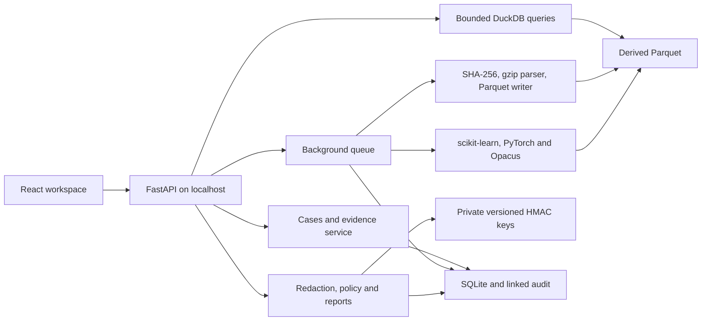
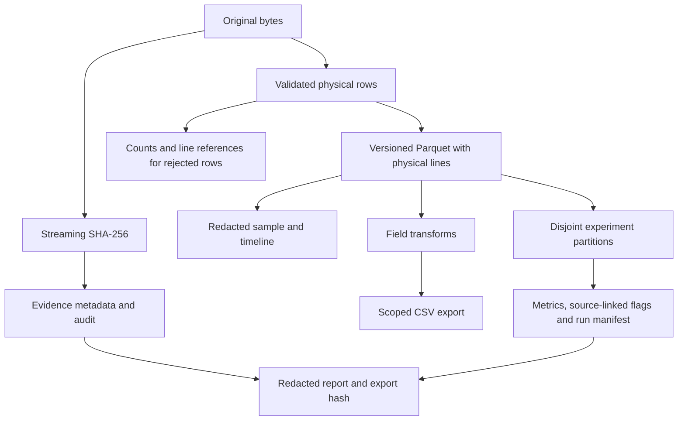

# Architecture and data flow

PrivForensics runs as a same-origin local application. React groups interactions by investigation. FastAPI validates request fields, routes requests to Python services and serves the built frontend. A single local background worker makes job submission, cancellation and resource measurement predictable. An OS lock keeps a second instance from sharing a data directory.

## Data flow

## Module map

| Service | Responsibility |
|---|---|
| `cases.py`, `db.py` | Investigation metadata, state counts, SQLite constraints and linked audit entries |
| `jobs.py` | Persistent queue state, active duplicate suppression, progress and cooperative cancellation |
| `evidence.py` | Path authorization, source stability checks, fixed-block hashing |
| `data.py` | Header and row parsing, bounds, validation, compressed streaming, incremental Parquet and query budgets |
| `correlation.py` | Role-aware, source-linked association rules and finding attachments |
| `privacy.py` | Structured and regex detection, explainable risk rules, masked previews and versioned domain-separated HMAC |
| `experiments.py` | Model fitting, disjoint partitions, privacy accounting, synthetic leakage diagnostics and telemetry |
| `reporting.py` | Redacted previews and eight report types, hashed exports in four formats |
| `api.py`, `frontend/src/` | Validated endpoints, typed client, route groupings and UI state |

## Trust boundaries

The current OS user controls the original sources and application storage. File registration resolves allowed roots and verifies the source identity during reads. A hash change blocks ingestion until the investigator verifies a matching source or registers a new version. Parquet contains validated source values and requires the same local protection as original evidence. User-facing samples redact structured identifiers and detected patterns. Reveals are individually confirmed and logged.

The audit chain links each entry to the preceding digest and can detect edits and missing interior records. A person who can rewrite the full database and recalculate every digest can replace local history. The application documents source handling as performed and leaves external custody procedures to the investigation.

## Correlation scope

The LANL Cyber1 case streams share an elapsed clock only when the investigator registers compatible sources for that case. Generated fixtures have their own clock. R1 requires exact elapsed time, source account, source host and destination host. R2 requires a supported account–host role pair inside the configured interval. R3 uses repeated accounts for the synthetic stream. Known reference matches, unlabelled records and model flags have distinct labels. [LANL source schemas](https://csr.lanl.gov/data/cyber1/)
